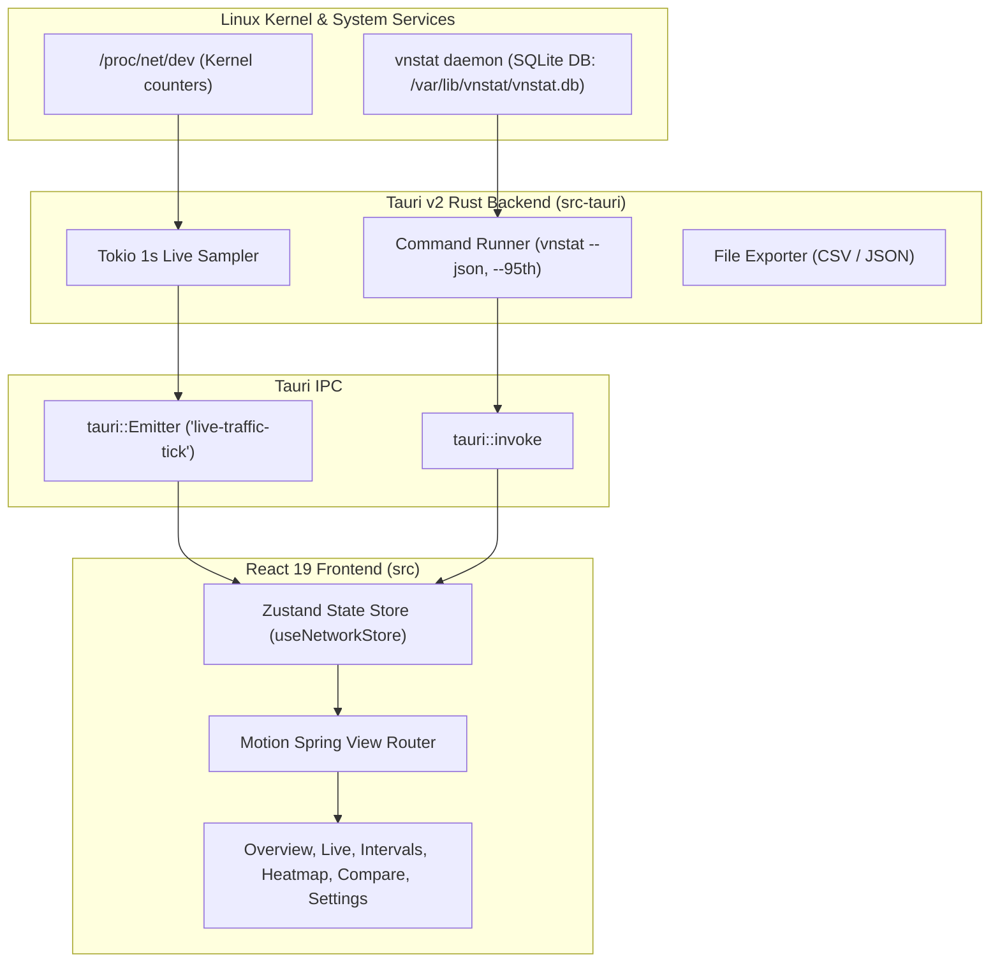

# NetPulse — Desktop vnStat Telemetry Suite (macOS Sequoia Edition)

A native Linux desktop application wrapping the [`vnstat`](https://linux.die.net/man/1/vnstat) network monitor daemon, engineered with Apple design craft, Emil Kowalski interaction physics, and comprehensive telemetry coverage.

Built with **Tauri v2 (Rust)**, **React 19**, **TypeScript**, **Bun**, **Tailwind CSS**, **Lucide Icons**, and **Motion**.

---

## 🌟 Key Features

### 📊 Complete vnStat Telemetry Suite
- **Overview Dashboard**: Today's RX/TX vs yesterday, month-to-date run-rate forecast, 95th percentile burst rate, and 24-hour visual activity timeline.
- **Live Bandwidth Cockpit**: High-frequency sub-second bandwidth streaming directly from `/proc/net/dev`, 60-second rolling area chart, dual download/upload speedometers, and packet rate meters.
- **5-Minute Intervals**: High-resolution 300-second sample slots, micro-burst step curves, and average transfer rates.
- **24-Hour Timeline**: Hourly distribution profile, peak transfer hour detection, and 95th percentile threshold line.
- **Daily History**: Day-by-day logs, day-of-week badges, and weekday vs weekend average bandwidth comparison.
- **Monthly Trends**: Multi-month volume comparison, month-over-month percentage deltas, and estimated daily burn rates.
- **Yearly Records**: Long-term annual cumulative totals and multi-year growth.
- **All-Time Top Records**: Top 25 bandwidth record leaderboard with podium medal styling (#1 Gold, #2 Silver, #3 Bronze).
- **7×24 Activity Heatmap**: Interactive GitHub-style network density matrix across days of week and hours of day.
- **Multi-Interface Comparison**: Side-by-side traffic distribution across all network cards (`wlan0`, `eth0`, VPN/WARP) with instant device switching.
- **Quota & Billing Tracker**: Configurable monthly data cap with alert thresholds, billing cycle renewal day, and daily allowance budget.
- **Dedicated Help & Documentation Center**: In-app search for networking topics, metric formulas (95th percentile, run-rate forecast, traffic balance), unit comparison matrix (SI vs IEC vs Bits), and interactive vnStat CLI cheatsheet.
- **Component Contextual Help**: Micro `HelpTooltip` icons across all metrics, charts, tables, and settings explaining formulas and behaviors on hover/click with origin-aware spring physics.
- **Full Settings & Interface Manager**: Register untracked network adapters (`vnstat --add`), unregister interfaces (`vnstat --remove`), synchronize database counters on demand (`vnstat -u`), set custom interface aliases (`vnstat --setalias`), configure quota alert thresholds, and export datasets.
- **Data Export Center**: Export telemetry to CSV or raw JSON files, or copy structure to clipboard.

### 🎨 Apple & Emil Kowalski Design Language
- **6 Calibrated Appearance Themes**:
  - **Cyber Neon (Default)**: Electric cyan and violet accents over midnight navy glass surfaces.
  - **Graphite (macOS Pro)**: Pure neutral charcoal obsidian with Apple System Blue, Apple Green RX, Apple Orange TX, and zero blue glare.
  - **Solar (Warm Night Shift)**: Espresso dark background with golden amber and terracotta copper accents; 100% blue-light-free for evening sessions.
  - **Emerald (Terminal Obsidian)**: Deep forest-tinted obsidian with jade green RX and lime TX; sysadmin terminal vibe.
  - **Nordic (Arctic Slate)**: Cold Scandinavian slate with muted sea blue and frosted white accents.
  - **macOS Light Mode**: Daytime platinum glass with dark charcoal typography, royal blue primary accents, and refined contrast.
- **Deep Theme Reactivity**: All metric cards, speedometer gauges, SVG area charts, bar distributions, heatmaps, tables, and typography react dynamically to CSS tokens (`var(--accent-primary)`, `var(--accent-rx)`, `var(--accent-tx)`, `var(--text-main)`, `var(--text-muted)`), guaranteeing optimal contrast and legibility across all dark and light themes without hardcoded artifacts.
- **Instant Theme Switching**: 1-click header palette quick-picker popover and full visual swatch gallery in Settings.
- **Translucent Glass Materials**: Frosted acrylic cards with `backdrop-filter: blur(24px)` and specular border highlights.
- **Micro-Interaction Physics**: Responsive Emil Kowalski scale feedback (`transform: scale(0.97)` on `:active` with 160ms cubic-bezier transition).
- **Fluid Spring Motion**: Critically damped springs (`bounce: 0`, `duration: 0.25-0.35s`) for non-distracting navigation transitions.
- **Tabular Figures**: High-precision `font-mono tabular-nums` to eliminate number jitter during real-time streaming.
- **Unit Modes**: Instant toggle between **SI** (KB/MB/GB), **IEC** (KiB/MiB/GiB), and **Bits** (Kbps/Mbps/Gbps).

---

## 🏗️ Architecture



---

## 🚀 Getting Started

### Prerequisites
- **Linux** (Tested on Arch Linux / CachyOS with Wayland and X11)
- **vnstat daemon** installed and running:
  ```bash
  sudo systemctl enable --now vnstat
  ```
- **Bun** (>= 1.2)
- **Rust / Cargo** (>= 1.85)

### Installation
```bash
# Clone the repository
git clone https://github.com/your-username/VNstat.git
cd VNstat

# Install frontend dependencies
bun install
```

### Running in Development
```bash
# Launch the native desktop application
bun run tauri dev

# Or run frontend standalone in browser (with simulated telemetry)
bun run dev
```

### Building for Production
```bash
# Build native Linux binary package
bun run tauri build
```
The compiled release executable and `.deb` / `.appimage` / `.tar.gz` packages will be generated in `src-tauri/target/release/bundle/`.

---

## 🧪 Testing

```bash
# Run unit test suite (formatters, formulas, heatmap calculation)
bun test

# Run TypeScript type check
bun tsc --noEmit

# Run Rust cargo check
cargo check --manifest-path src-tauri/Cargo.toml
```

---

## 📄 License
MIT License.
