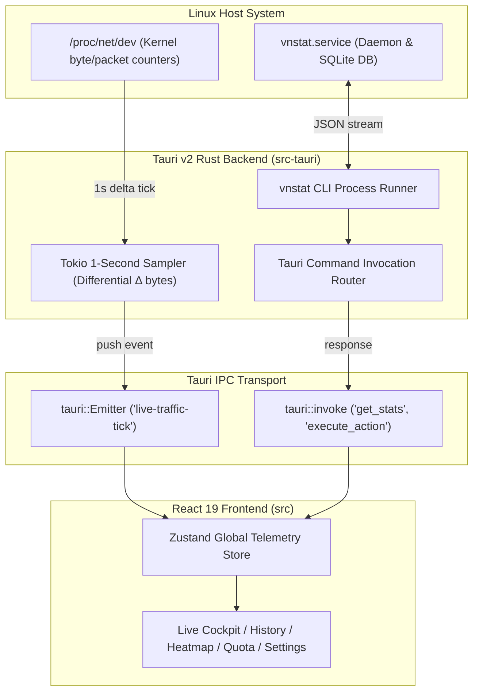

<div align="center">


# NetPulse

### Native Linux Desktop vnStat Telemetry & Network Bandwidth Monitor

[](https://github.com/th3mw/netpulse/releases)
[](https://aur.archlinux.org/packages/netpulse-bin)
[](LICENSE)
[](https://th3mw.github.io/netpulse/)
[](https://github.com/th3mw/netpulse)

<p align="center">
  A high-performance, native desktop telemetry interface for the <a href="https://linux.die.net/man/1/vnstat"><code>vnstat</code></a> background daemon. Engineered with Tauri v2 (Rust) and React 19, delivering sub-second real-time streaming, persistent historical metrics, and complete adapter lifecycle management.
</p>

[**Website**](https://th3mw.github.io/netpulse/) • [**Download Releases**](https://github.com/th3mw/netpulse/releases) • [**AUR Package**](https://aur.archlinux.org/packages/netpulse-bin) • [**Architecture**](#-architecture--data-flow)

</div>

---

## 📑 Table of Contents

- [Overview](#-overview)
- [Architecture & Data Flow](#-architecture--data-flow)
- [Core Capabilities](#-core-capabilities)
  - [Live Bandwidth Cockpit](#1-live-bandwidth-cockpit)
  - [vnStat Historical Telemetry](#2-vnstat-historical-telemetry)
  - [7×24 Activity Density Heatmap](#3-724-activity-density-heatmap)
  - [Quota Budgeting & Billing Tracker](#4-quota-budgeting--billing-tracker)
  - [Adapter Management & CLI Integration](#5-adapter-management--cli-integration)
- [Visual Themes](#-visual-themes)
- [Installation](#-installation)
  - [Arch Linux / AUR](#arch-linux--aur)
  - [Debian / Ubuntu / Pop!_OS](#debian--ubuntu--pop_os)
  - [Universal AppImage](#universal-appimage)
  - [Fedora / RHEL / openSUSE](#fedora--rhel--opensuse)
  - [Building from Source](#building-from-source)
- [Configuration & Daemon Setup](#-configuration--daemon-setup)
- [Development & Verification](#-development--verification)
- [Troubleshooting](#-troubleshooting)
- [License](#-license)

---

## 🔭 Overview

`vnstat` is the gold standard for lightweight, persistent network logging on Linux. Operating quietly as a background daemon, it tracks traffic counters without packet sniffing or consuming kernel overhead.

**NetPulse** bridges the gap between terminal metrics and desktop operations. It pairs real-time, high-frequency `/proc/net/dev` sampling with `vnstat`'s SQLite database to provide:

1. **Sub-second live streaming**: 60-second rolling telemetry with dynamic Y-axis auto-benchmarks.
2. **Deep historical analytics**: 5-minute slots, hourly distribution, 24-hour timeline, daily, monthly, and yearly traffic profiles.
3. **Multi-adapter management**: Add, remove, synchronize, alias, and monitor interfaces on the fly without memorizing CLI syntax.
4. **Zero Electron bloat**: Native binary footprint powered by Tauri v2 with WebKitGTK and Rust.

---

## 🏗️ Architecture & Data Flow

NetPulse utilizes a dual-path telemetry architecture: high-frequency real-time sampling runs in Rust async tasks, while structured historical telemetry queries the `vnstat` daemon.



- **Live Stream Engine**: Reads raw byte counters directly from `/proc/net/dev` every 1,000ms. Computes the first derivative ($\Delta \text{bytes} / \Delta t$) to provide accurate current download and upload speeds without taxing the vnStat SQLite store.
- **Historical Engine**: Parses `vnstat --json` schemas across all granularities (5-minute, hourly, daily, monthly, yearly, top 25).
- **Persistent Interface Selection**: Supports setting a starred default network interface that persists across desktop reboots via local configuration.

---

## ⚡ Core Capabilities

### 1. Live Bandwidth Cockpit
- **Dual Speedometers**: Dedicated instant download (RX) and upload (TX) gauges.
- **60-Second Rolling Area Chart**: Continuous high-frequency bandwidth waveforms with linear gradient fills.
- **Side Y-Axis Dynamic Benchmarks**: Benchmark scale positioned on the left side, auto-scaling up to Gbps speeds without overlapping wave visualizers.
- **Interactive Scrubber**: Hover over any point in the 60-second window to inspect exact transfer rates at that timestamp.

### 2. vnStat Historical Telemetry
- **Side-by-Side Dual-Pillar Bar Charts**: Download and upload volumes rendered side-by-side with left Y-axis volume references and horizontally scrollable overflow.
- **5-Minute High-Resolution Records**: Inspect short-duration traffic bursts with micro-interval tables.
- **24-Hour Profile**: View peak usage hours, 95th percentile burst limits, and traffic balance ratios.
- **Daily & Monthly Logs**: Day-of-week classification, weekday vs. weekend distribution, and month-over-month rate forecasts.
- **All-Time Records Leaderboard**: Top 25 historical transfer days with gold, silver, and bronze podium badges.
- **Pagination Controls**: Configurable pagination (10, 25, 50, 100 rows per page) on 5-minute, hourly, and daily data tables.
- **European Date Standard**: Strict `DD/MM/YYYY` timestamps across all views and tooltips.

### 3. 7×24 Activity Density Heatmap
- GitHub-style network density matrix tracking traffic across all 168 hours of the week.
- Identifies usage patterns, recurring backup windows, and anomalous off-hours bandwidth consumption.

### 4. Quota Budgeting & Billing Tracker
- Set custom monthly allowances (e.g., 500 GB or 1 TB) and billing cycle start dates.
- Calculates projected end-of-month burn rate, remaining daily budget, and warning threshold alerts.

### 5. Adapter Management & CLI Integration
- **Zero Terminal Requirement**: Add untracked adapters (`vnstat --add -i <iface>`), drop unneeded interfaces (`vnstat --remove -i <iface>`), or trigger immediate database flushes (`vnstat -u -i <iface>`) directly from Settings.
- **Custom Interface Aliases**: Assign readable labels (e.g., `Home Fiber`, `Work VPN`, `LTE Hotspot`) via `vnstat --setalias`.
- **Export Center**: Instant export to structured CSV and JSON, or copy to clipboard for scripting.

---

## 🎨 Visual Themes

NetPulse includes 6 carefully calibrated visual themes optimized for high contrast and legible metric visualization:

| Theme | Type | Description |
| :--- | :--- | :--- |
| **Cyber Neon** (Default) | Dark | High-tech cyan and violet accents on deep navy surfaces. |
| **Graphite** | Dark | Neutral obsidian charcoal with classic blue, emerald RX, and amber TX accents. |
| **Solar** | Dark | Low blue-light espresso palette with amber and copper accents for night sessions. |
| **Emerald** | Dark | Deep terminal obsidian with vivid jade green and lime data streams. |
| **Nordic** | Dark | Crisp Scandinavian slate with muted sea blue and icy highlights. |
| **Studio Light** | Light | High-contrast daytime platinum surface with charcoal typography and royal blue highlights. |

All metrics, graphs, tables, and gauges adapt dynamically to theme CSS variables with zero hardcoded contrast artifacts.

---

## 📦 Installation

### Arch Linux / AUR

NetPulse is packaged for Arch Linux and derivative distributions (CachyOS, EndeavourOS, Manjaro) on the AUR:

```bash
# Using yay
yay -S netpulse-bin

# Using paru
paru -S netpulse-bin
```

### Debian / Ubuntu / Pop!_OS

Download the `.deb` package from the [Releases Page](https://github.com/th3mw/netpulse/releases). The package automatically manages the `vnstat` dependency:

```bash
sudo dpkg -i netpulse_*_amd64.deb
sudo apt-get install -f # Fix missing dependencies if required
```

### Universal AppImage

The standalone AppImage runs on any modern Linux distribution without installation:

```bash
chmod +x NetPulse_*.AppImage
./NetPulse_*.AppImage
```

### Fedora / RHEL / openSUSE

Download the `.rpm` package from the [Releases Page](https://github.com/th3mw/netpulse/releases):

```bash
sudo dnf install ./netpulse-*.x86_64.rpm
```

---

### 🛠️ Building from Source

NetPulse requires [Bun](https://bun.sh/) (>= 1.2) and [Rust](https://rustup.rs/) (>= 1.85).

```bash
# 1. Clone repository
git clone https://github.com/th3mw/netpulse.git
cd netpulse

# 2. Install system development headers (Debian/Ubuntu example)
sudo apt update && sudo apt install -y \
  libwebkit2gtk-4.1-dev \
  build-essential \
  curl wget file \
  libxdo-dev libssl-dev \
  libayatana-appindicator3-dev \
  librsvg2-dev

# 3. Install frontend dependencies with Bun
bun install

# 4. Launch in development mode
bun run tauri dev

# 5. Build optimized release binaries
bun run tauri build
```

Generated binaries will be available in `src-tauri/target/release/bundle/`.

---

## ⚙️ Configuration & Daemon Setup

NetPulse relies on the `vnstat` service to collect historical records. Ensure the service is active:

```bash
# Check vnstat daemon status
systemctl status vnstat

# Enable and start daemon if inactive
sudo systemctl enable --now vnstat

# Initialize a specific network interface (e.g. wlan0 or eth0)
sudo vnstat --add -i wlan0
sudo systemctl restart vnstat
```

Within NetPulse:
- Open **Settings** to mark your primary adapter with the **Star** icon; this sets it as the persistent default on startup.
- Select your preferred unit format: **SI** (KB/MB/GB), **IEC** (KiB/MiB/GiB), or **Bits** (Kbps/Mbps/Gbps).
- Configure your monthly quota and billing cycle renewal date.

---

## 🧪 Development & Verification

NetPulse adheres to strict type safety and unit testing standards:

```bash
# Run unit tests (formatters, date normalization, rate math, heatmap builder)
bun test

# Run TypeScript type verification
bun tsc --noEmit

# Verify Rust backend logic
cargo check --manifest-path src-tauri/Cargo.toml
```

---

## ❓ Troubleshooting

| Issue | Cause | Solution |
| :--- | :--- | :--- |
| **"Interface not found"** or empty charts | `vnstat` daemon not logging the interface | Run `sudo vnstat --add -i <interface>` followed by `sudo systemctl restart vnstat`. |
| **Live speed reads 0 B/s** | Interface inactive or permissions on `/proc/net/dev` | Verify interface has active traffic with `ip -s link show <interface>`. `/proc/net/dev` is world-readable by default. |
| **Data shows "Not enough data"** | New installation | `vnstat` needs at least 5 minutes of samples to populate interval records. Keep the daemon running. |

---

## 📄 License

Distributed under the **MIT License**. See [LICENSE](LICENSE) for details.
